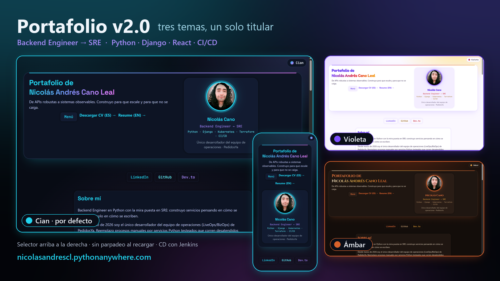

# Nicolás Andrés Cano Leal

**Backend Engineer → SRE | Python · Django · Kubernetes · Terraform · CI/CD**
I replace manual operational processes with tested, observable, automated systems — and I run them in production.

📍 Rancagua, Chile · UTC-4 · open to remote work (EN/ES)
🌐 [nicolasandrescl.pythonanywhere.com](https://nicolasandrescl.pythonanywhere.com) · 💼 [LinkedIn](https://www.linkedin.com/in/nicolas-andres-cano-leal) · 📧 nicolas.cano.leal@gmail.com

> 🇪🇸 Resumen en español [al final](#-en-español).

---

## What I do

I'm a **Live Performance Agent at PedidosYa Chile** (LiveOps / BizOps) and the **sole developer on my operations team**. That combination is the point: I sit inside the operation, so I know which 40 minutes of manual work are worth killing before I write a line of code.

Formal training in Ingeniería en Informática (IP Santo Tomás) and 2,500+ hours of self-directed study since February 2025, structured with the Ultralearning method. Previous career as a nursing technician (TENS) — which is where the habit of working under pressure without dropping the checklist comes from.

---

## Selected work

### 🤖 LiveOps Engine "Jaime" — production, company-owned (private repo)

The automation platform my team runs on every day. Inherited from a colleague in April 2026 and evolved solo since: **654 of the repo's 962 commits** are mine, covering **18 releases, v4.0 → v6.7**, in about six months.

- **~68,000 lines across 230 modules**, **2,800+ tests**, CI on GitHub Actions verified on a clean clone before every push
- **10 engines running in parallel** over isolated browser profiles, each on its own schedule (dispatch monitoring, reporting, alerting, forecast, end-of-day closing, operator presence)
- Integrations: Selenium 4 / Playwright over the internal dispatch platform, Google Sheets, Slack, **BigQuery**, Grafana PDF parsing with pdfplumber
- **Criticality models in production** (AUC 0.77–0.86, retrained on fresh data) that warn coordinators before a zone degrades, instead of after

Engineering highlights: zero-downtime UI migration from CustomTkinter to NiceGUI using a strangler-fig pattern; thread-safe reassignment cooldown system; a real fix for a `RecursionError` caused by three wrappers reassigning `sys.stdout` without a lock (routed streams via `threading.local` + reentrancy guard); cross-process log rotation with a PID-validated single-instance lock; a dedicated "clean house" release that removed ~12k lines of dead UI and cut `config.py` from 923 to 199 lines; spreadsheet columns read by header text, so a new column in the middle no longer silences an alert.

Measured results: bucket report **20–25 min → under 5 min**; Google Sheets read latency **~16 min → under 1 min**; reassignment bottleneck **~37 min → ~10 min** (by proving the cost was the platform's cooldown, not my code).

Presented to ~100 people at the Log & Ops Summit, July 2026.

---

### 🔍 Incident dossier collector — private (handles real personal data)

Django/DRF + NiceGUI service over BigQuery that assembles investigation dossiers from six sources, replacing ~40 minutes of manual collection across four tabs.

- Pure resolver core with IO at the edges; **660 tests**, BigQuery client injected as a test double with fixtures captured from real responses
- A measured audit found the main source had dropped to **0.11% coverage**; the timeline moved to a table with 100% coverage and 13 months of retention
- No models, no local DB — the dossier is read fresh each time so a second source of truth never appears
- Deliberate design constraint: **the system never concludes anything.** No verdict, score or recommendation fields, enforced by a test that fails if anyone adds them

### 🔁 Cancelled-order participants sync — private

Reads an event stream in BigQuery (read-only) and publishes idempotently to Google Sheets without overwriting what analysts annotate. Ports and adapters: moving the destination from BigQuery to Sheets cost configuration, not domain code. Decisions recorded as ADRs with UML. **312 tests, 80% coverage.**

---

### 🎨 [This portfolio, v2.0](https://nicolasandrescl.pythonanywhere.com) — public ([backend](https://github.com/NicolasAndresCL/MiPortafolioDjango) · [frontend](https://github.com/NicolasAndresCL/Portafolio-Frontend-React))

Django 5.2 + DRF API with the React 19 build embedded and served by Django, PostgreSQL on Neon, deployed on PythonAnywhere.

- **Three themes** (Cian, Violeta, Ámbar) switched from the top-right corner: each theme is a Stitches class on `<html>`, so switching never re-renders React, and an inline script applies the saved theme before the app loads — no flash on reload
- One headline across portfolio, CV and LinkedIn; bilingual CV generated from versioned HTML
- **35 frontend + 49 backend tests (~91% coverage)**, mypy; a script replays the CI on a clean clone before every commit
- CD through **Jenkins**: test gate → image build → deploy → healthcheck → smoke test, isolated from the production database

---

### 🧱 [All in Django](https://github.com/NicolasAndresCL/All_in_Django) — public

Django 6 + DRF rebuild of a Streamlit mega-project that had consolidated 7 earlier ones. Study calendar, personal and team shift management, task log, notes and a scraping module — one HTTP contract, UI fully decoupled from the ORM.

- Python 3.14, Django 6, DRF, pydantic-settings, Postgres 16 (psycopg v3), gunicorn + WhiteNoise
- **284 tests, 80% minimum coverage enforced in CI**; TokenAuth + throttling everywhere, `check --deploy` clean
- Full IaC: multi-stage non-root Docker + Compose with healthchecks, GitHub Actions, **Terraform (EC2 + RDS)**, Helm/K8s manifests, and CD through a declarative Jenkinsfile deploying GHCR images

---

### 🐧 [ultimate-linux-lab](https://github.com/NicolasAndresCL/ultimate-linux-lab) — public

A disposable Linux lab in Docker: Ubuntu 24.04 with **real systemd as PID 1**, a GNOME desktop reachable from the browser (TigerVNC → noVNC, bound to loopback only), dual persistence, non-root user.

- Split into two stages: `base` (539 MB, 2–3 min) and `desktop` (2.67 GB)
- CI with hadolint, shellcheck, compose validation, a smoke test against the real container, **Trivy with SARIF** to the Security tab, and publishing to GHCR — plus a hardening check that verifies ports stay on loopback and the password stays parameterizable
- Dependabot, issue/PR templates, Conventional Commits, MIT

Built after a hand-configured VM corrupted itself. The lesson it encodes: infrastructure you can't rebuild from a file isn't infrastructure.

---

## Stack

**Languages** Python (primary), SQL, Bash, some Java and JavaScript
**Backend** Django · DRF · FastAPI · Flask · NiceGUI · Pydantic · OpenAPI
**Frontend** React · Vite · Stitches · Radix UI
**Data & ML** BigQuery · PostgreSQL · MySQL · pandas · NumPy · scikit-learn · PySpark · Power BI
**Automation** Selenium · Playwright · gspread · Slack SDK · n8n · VBA→Python migrations
**Infra & CI/CD** Docker · Compose · GitHub Actions · Jenkins · Terraform · Kubernetes/Helm · GHCR · Trivy · Linux · systemd
**Practice** pytest · mypy · Conventional Commits · CI wired from day one · ruff

---

## Where I'm heading

Target role: **Site Reliability Engineer**, international remote market. Path I'm walking deliberately: Backend → DevOps → SRE → Software Architect.

Certifications in progress, chosen against my actual gaps: **Terraform Associate**, **Google Cloud Professional Cloud DevOps Engineer**, **CKA**, **Prometheus Certified Associate**.

I know my current bottleneck: I'm a sole developer, so nobody reviews my architecture but me. I'm looking for a team where that stops being true.

---

## 🇪🇸 En español

**Backend Engineer → SRE.** Soy Live Performance Agent en PedidosYa Chile y el único desarrollador del equipo de operaciones: reemplazo procesos manuales por servicios Python testeados que corren desatendidos en producción.

- **LiveOps Engine "Jaime"**: plataforma de automatización del equipo; 18 versiones (v4.0 → v6.7) desde abril de 2026, ~68.000 líneas, 2.800+ tests y modelos de criticidad en producción.
- **Recolector de dossiers** (660 tests) y **sincronización de participantes** (312 tests): Django/DRF y BigQuery con arquitectura limpia.
- **Este portafolio v2.0**: Django + React con tres temas, CI en GitHub Actions y CD con Jenkins.
- **All in Django** y **ultimate-linux-lab**: IaC completa (Docker, Terraform, Helm) y CI desde el primer commit.

Busco un rol de **SRE** remoto, en un equipo donde alguien más revise mi arquitectura.

---

> *"El buen software no solo se escribe, se entiende y se evoluciona."*
> *"Good software isn't just written — it's understood and evolved."*
